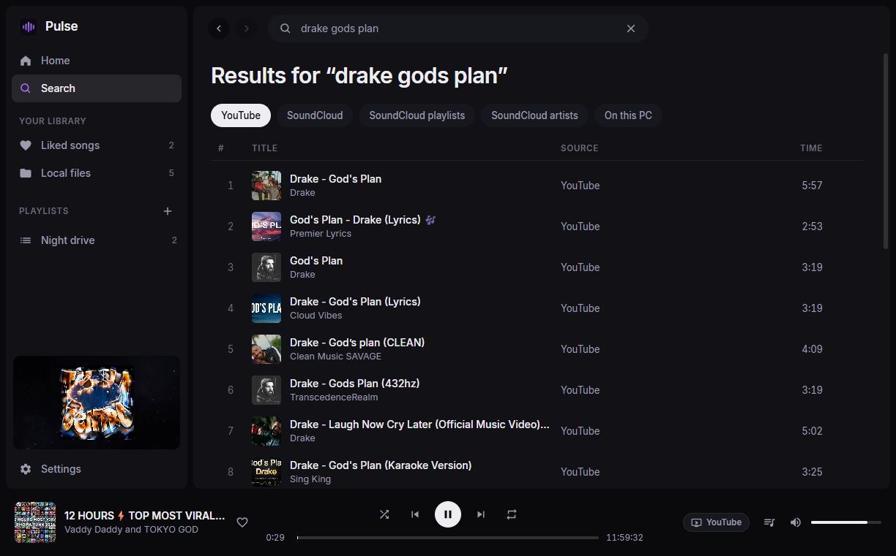
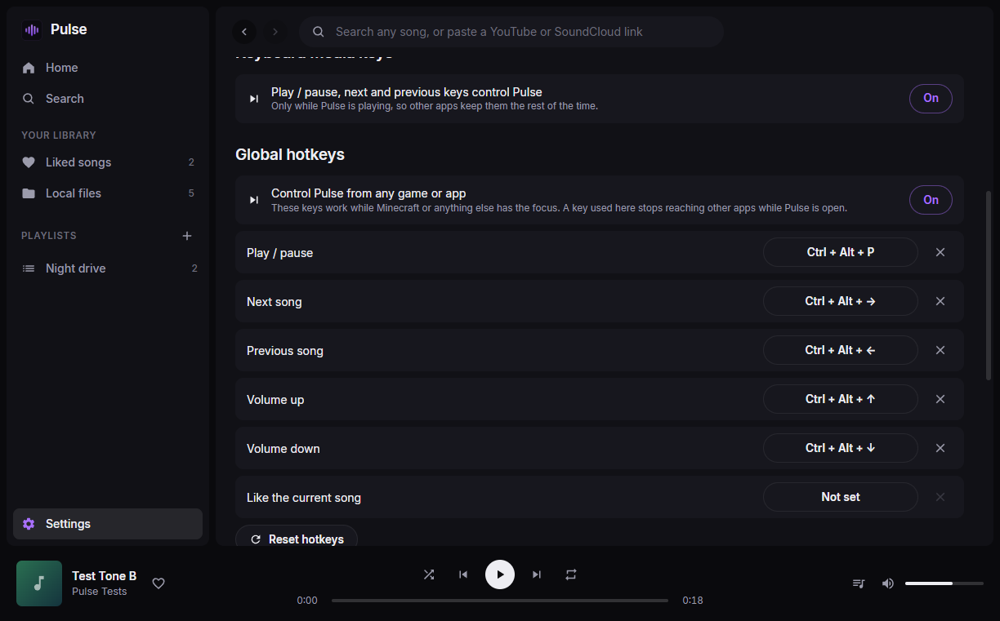
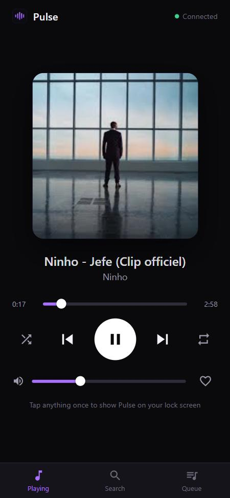

# Pulse

A small music player for Windows. Search any song, press play, no ads.

It plays from YouTube, SoundCloud and the music files on your PC, in one clean window that weighs under 3 MB.



## Download

Get the zip from the [latest release](https://github.com/GraveRich/pulse/releases/latest), unzip it anywhere and run `Pulse.exe`.

- Needs Windows 10 or 11 (64-bit). It uses the Edge WebView2 runtime that Windows 11 already has; on Windows 10 it comes with Microsoft Edge.
- The app is not code-signed, so Windows may show "Windows protected your PC" the first time. Click **More info**, then **Run anyway**.
- Your likes, playlists and settings are kept in `%APPDATA%\Pulse`. Deleting the app folder does not delete them.

## What it does

- **Search any song.** Results come from YouTube; SoundCloud has its own tabs. Pasting a YouTube or SoundCloud link works too.
- **No ads.** Pulse has none of its own, and it blocks the ads of the embedded YouTube player.
- **Your own files.** MP3, FLAC, M4A, OGG, Opus and WAV, with covers and albums.
- **Likes, playlists and a queue**, mixing songs from all three sources. Shuffle and repeat.
- **Fast song changes.** The next song is loaded in advance, with an optional crossfade (Settings > Song changes).
- **Hotkeys that work inside games.** Next, previous, play/pause and volume from any app (Settings > Global hotkeys). Keyboard media keys work too.
- **Phone remote.** Scan a QR code and control Pulse from your phone on the same Wi-Fi. On an iPhone or Android phone it also shows on the lock screen (Settings > Phone remote).
- **Optional account.** Keeps your likes and playlists online so a new PC or a reinstall does not lose them.

| Hotkeys | Phone remote |
|---|---|
|  |  |

## Accounts and your data

The account is optional. Without one, nothing leaves your PC except the searches and the playback itself.

With an account (Settings > Account):

- You pick a username and a password. There is no email.
- What is stored online: the username, a hash of the password (PBKDF2-SHA256), a hash of your recovery code, hashes of your sign-in tokens, and your liked songs, playlists and saved SoundCloud pages (links and titles). Songs from your own files are never uploaded, not even their names.
- Not stored: IP addresses, what you listen to, anything about your PC.
- You get a recovery code once, when you create the account. It is the only way back in if you forget the password, because there is no email to send a reset to.
- **Delete account** in Settings removes all of it from the server.

The server is a small Cloudflare Worker. Its whole code is in [`server/`](server/), so you can read what it does or run your own.

## Things to know

- Pulse plays YouTube and SoundCloud through their own official embedded players. Nothing is downloaded or saved.
- Blocking the ads of the YouTube player is against YouTube's terms of service. YouTube also changes its player often, so ads can come back until Pulse is updated. Use it knowing that.
- Some SoundCloud songs from big labels only play on soundcloud.com. Pulse hides them.
- A few YouTube videos only play on youtube.com. Pulse skips them.
- Pulse is not affiliated with YouTube, Google or SoundCloud.

## Build it yourself

No SDK needed: it compiles with the C# compiler that ships with Windows.

```powershell
.\build.ps1
```

That builds and installs to `%LOCALAPPDATA%\Programs\Pulse` with Desktop and Start-menu shortcuts. `.\build.ps1 -Out <folder>` builds somewhere else without shortcuts.

- `src\Program.cs`: the window, a localhost server for the UI and your music files, YouTube and SoundCloud lookups, the ad filter, hotkeys and the phone-remote server.
- `ui\`: the interface (plain HTML, CSS and JavaScript) and the phone page `remote.html`.
- `server\`: the account server (Cloudflare Worker + D1). `node server\test.mjs` checks it against a local `wrangler dev`.
- `docs\DEV-NOTES.txt`: how the parts work, command-line flags for testing, and what was tried and did not work.

## Third-party parts

- Microsoft Edge WebView2 SDK (`lib\Microsoft.Web.WebView2.*.dll`, `lib\WebView2Loader.dll`), see `lib\WebView2-LICENSE.txt`.
- TagLib# 2.3.0 (`lib\TagLibSharp.dll`), LGPL 2.1, used unmodified to read song tags. Source: https://github.com/mono/taglib-sharp
- Inter font (`ui\fonts`), SIL Open Font License, see the licence file in that folder.
